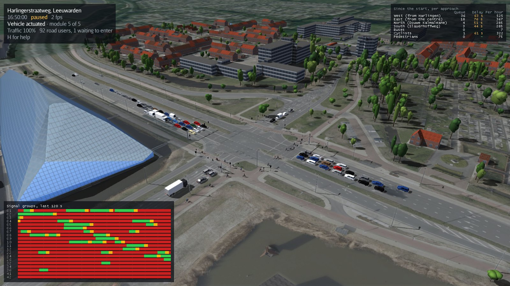
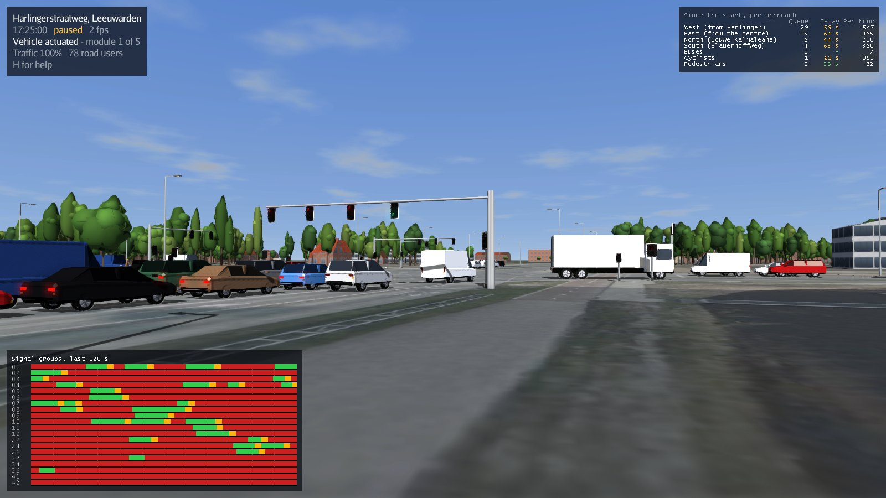
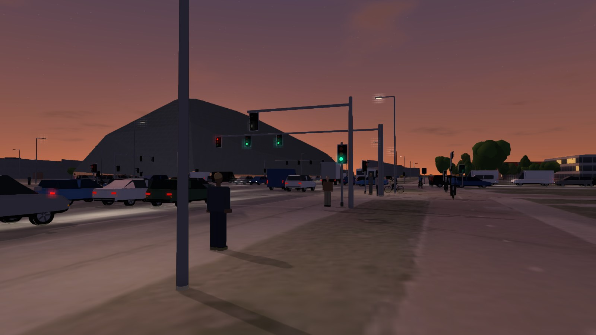
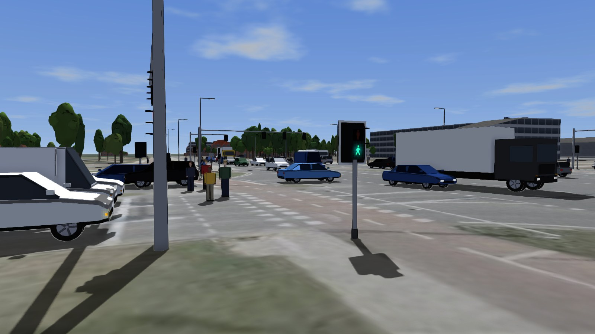
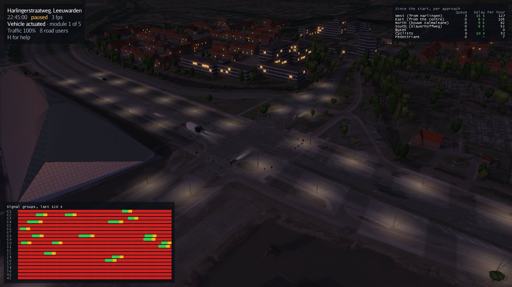
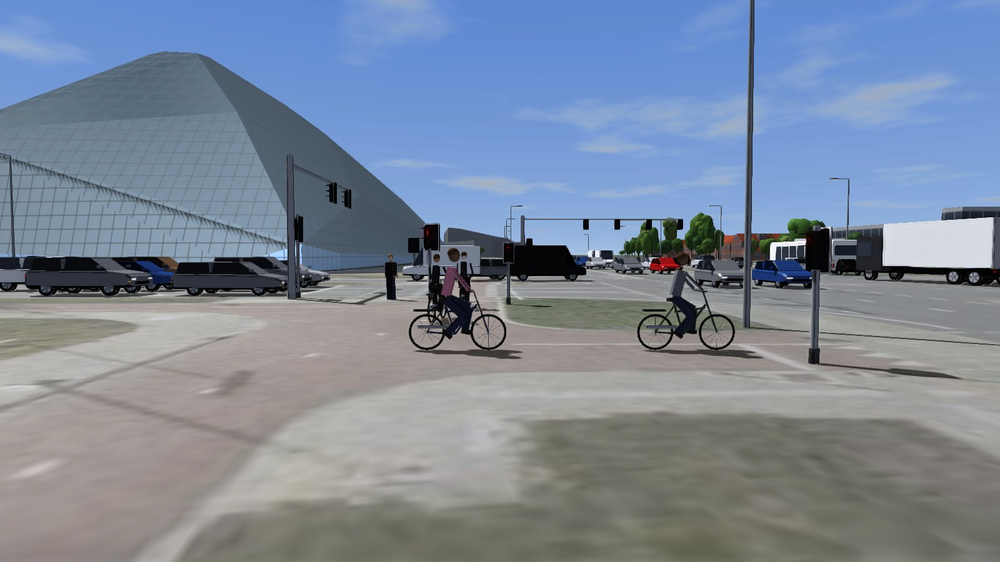
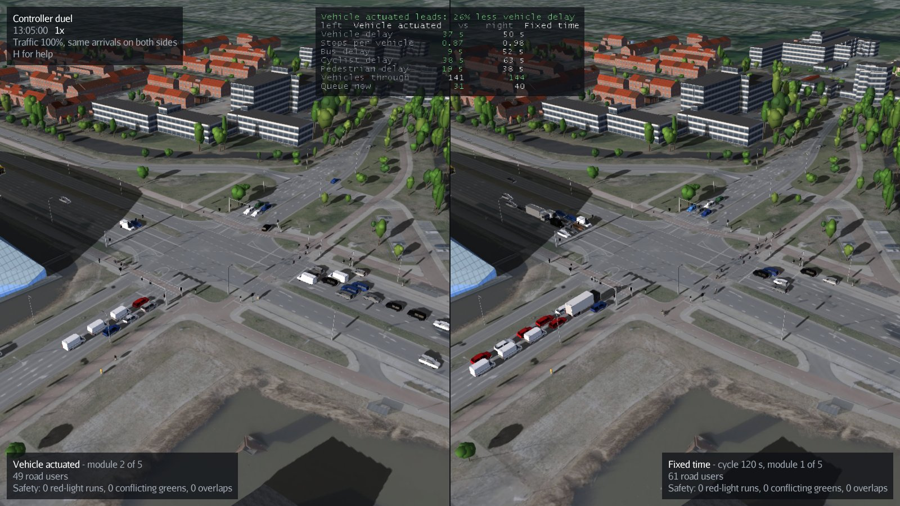

# Simplified Simulator

[](https://github.com/tosjo/SimplifiedSimulator/actions/workflows/build.yml)

A 3D traffic simulation of a real crossing in Leeuwarden: the Harlingerstraatweg with the
Douwe Kalmaleane and the Slauerhoffweg, next to the glass Crystallic building. Cars, vans,
lorries, buses, cyclists and pedestrians cross it under Dutch-style traffic light control,
and the simulator shows how well each controller handles the traffic.



Everything you see is built from open data about the real place:

- **Lanes, stop lines and traffic lights** from OpenStreetMap, checked lane by lane against
  the aerial photo.
- **The ground** is the PDOK aerial photo (8 cm per pixel), with the cars that happened to
  be on the road removed by combining the photos of 2024, 2025 and 2026.
- **616 buildings** with their real roof shapes from 3D BAG.
- **879 trees** at their real positions and heights, found in the national height model (AHN).

The simulator started in 2014 as a school project by Toby Zeldenrust and Herman ten Hoor,
using a drawing of this crossing as it was then (see [the original map](docs/2014-map.png)).
The crossing has since been rebuilt, and so has the simulator.

| Rush hour at street level | Dusk |
| --- | --- |
|  |  |
|  |  |
|  | |

## Running it

You need JDK 17 or newer and a graphics card with OpenGL 3.2. Gradle downloads everything
else.

**IntelliJ IDEA:** *File → Open* the cloned folder. IntelliJ recognises the Gradle project;
pick a run configuration and press ▶:

- **Run Simulator**: the crossing with the built-in vehicle-actuated controller.
- **Controller Duel**: our 2014 controller (left) against the smart controller (right), on
  the same traffic. It starts both Python controllers for you (Python 3.8 or newer must be
  installed) and stops them when you close the window.

**Command line:**

```sh
./gradlew run                                        # morning rush, vehicle-actuated controller
./gradlew run --args="--start 17:00 --speed 4"       # evening rush, four times as fast
./gradlew run --args="--controller fixed"            # compare with a fixed-time plan
./gradlew duel                                       # 2014 controller against the smart one
./gradlew duel -PduelArgs="--start 17:00"            # the duel at the evening rush
```

The duel runs at real speed: the Python controllers keep their own time, so leave the speed
at 1x there. The controllers' output goes to `build/duel/`.

On Windows, use `gradlew.bat` instead of `./gradlew`. `./gradlew installDist` builds a
standalone copy with start scripts in `build/install/simplified-simulator/`.

### Controls

| Key | Action |
| --- | --- |
| Drag / right-drag / wheel | Rotate / move / zoom the camera |
| `W` `A` `S` `D` | Move the camera; `F` switches to free flight (`Q`/`E` down/up) |
| Click a road user | Follow it and see why it waits; `V` driver's view, `Backspace` stop |
| `1` – `6` | Viewpoints: overview, from above, and street level on every approach |
| `Space` or `P` | Pause |
| `+` / `-` | Faster / slower (up to 64 times real time) |
| `C` | Next controller: vehicle actuated → fixed time → external |
| `[` / `]` | Less / more traffic |
| `T` / `G` / `H` | Signal timeline / statistics / help |
| `X` | Save the statistics as CSV |
| `F5` / `F6` / `F7` | Situations: morning rush (07:30), evening rush (17:00, 110% traffic), stress test (08:00, 200% traffic). The clock and traffic jump there, the road users stay and the statistics start again |
| `F12` | Screenshot |

### Options

| Option | Default | Description |
| --- | --- | --- |
| `--controller <name>` | `actuated` | `actuated`, `fixed` or `external` |
| `--start <HH:MM>` | `07:30` | Time of day to start; traffic and daylight follow the clock |
| `--speed <factor>` | `1` | Simulation speed |
| `--scale <factor>` | `1` | Multiply all traffic volumes |
| `--demand <file.csv>` | built in | Your own traffic volumes per route |
| `--seed <number>` | `1` | Random seed; the same seed gives the same traffic |
| `--host`, `--port` | `localhost:1337` | Address of an external controller |
| `--quality <level>` | `high` | `high`, `medium` or `low` |
| `--date <YYYY-MM-DD>` | today | Date for the position of the sun |
| `--camera <view>` | `overview` | `overview`, `birds_eye`, `street_west`, `street_east`, `street_north`, `street_south` |
| `--headless --duration <sec>` | | Run without a window and print the results (`--csv <file>` to save them) |
| `--screenshot <file> --duration <sec>` | | Simulate, save one picture and exit |
| `--duel <a>,<b>` | | Two controllers side by side on the same traffic (see below) |
| `--names <a>,<b>` | controller names | Labels for the two duel sides, for example `2014,Smart` |

## Comparing controllers

### Controller duel



`--duel` shows two controllers side by side, on exactly the same traffic: both sides get
the same arrivals from the seed, and one clock advances both by the same steps. The
camera of the right half follows the left one, so you always look at the same spot.

```sh
./gradlew run --args="--duel actuated,fixed"
./gradlew run --args="--duel actuated,external"   # against your own controller
```

The scoreboard at the top shows who leads on vehicle delay, and compares stops, delay
for buses, cyclists and pedestrians, vehicles through and the queue right now; the better
value is green. Each side shows its safety record, in red as soon as anything unsafe
happens. Speed, pause, traffic and the situation keys `F5`-`F7` work on both sides at once (a
situation also restarts the score), `R` reconnects the
external controllers and `X` saves both sides' statistics in one CSV. Clicking a road user
and switching controllers are off, since the sides have different road users and a
switch would spoil the score.

Two external controllers listen on `--port` and the next port (1337 and 1338 by default),
for example two copies of the Python controller started with `--port 1337` and
`--port 1338`. With an external controller neither side gets the usual warm-up, so both
start from an empty crossing. A duel draws the city twice, so it starts at medium quality;
`--quality high` overrides that. It smooths edges with FXAA instead of multisampling, because
jME draws a multisampled half-window in the wrong place. `--names 2014,Smart` labels the two
sides; two controllers of the same kind are otherwise called Left and Right.

### Batch runner

The batch runner simulates without graphics, about ten seconds per simulated hour:

```sh
./gradlew batch --args="--controllers fixed,actuated --seeds 4 --duration 7200 --start 07:00"
```

Two hours of morning rush, averaged over four random seeds:

| Controller | Vehicles | Average delay | Stops | Cyclists | Pedestrians | Buses |
| --- | --- | --- | --- | --- | --- | --- |
| Vehicle actuated | 4906 | 87 s | 1.29 | 62 s | 36 s | 30 s |
| Fixed time (120 s cycle) | 4699 | 133 s | 1.78 | 127 s | 28 s | 56 s |

The actuated controller gives green where traffic is waiting and stretches it while
vehicles keep coming, so it moves more traffic with less waiting. Pedestrians do slightly
better with the fixed plan, because it gives them green in every cycle without having to
press the button first.

## How it works

### Driving

Every road user follows a route: an approach lane, a path across the crossing and an exit
lane. Speed is decided by the
[Intelligent Driver Model](https://en.wikipedia.org/wiki/Intelligent_driver_model): drivers
keep a safe time gap to whoever is ahead, accelerate and brake smoothly, and slow down for
turns. Every driver gets slightly different settings, so some are more patient than others.
At amber a driver stops if that is possible with comfortable braking, and otherwise drives
on, like the Dutch rule.

Where paths cross or merge, road users never drive through each other: whoever is already
on the conflict area goes first, slip roads give way, and nobody enters an area they cannot
leave. Buses stop at the real *Westeinde* bus stop.

### Signal control

Signal groups are numbered the Dutch way: 01-12 motor traffic, 22-26 cyclists, 32-36
pedestrians and 41-42 buses. The simulator works out from the geometry which groups
conflict and the minimum time between one ending and the other starting (the intergreen
time, *ontruimingstijd*).

- **Vehicle actuated** (default): detection loops in the road, cyclist detectors and push
  buttons request green. The controller cycles through blocks of compatible groups, skips
  directions nobody is waiting for, extends green while loops keep detecting traffic, gives
  extra green to groups that fit in, and gives buses priority.
- **Fixed time**: the same blocks with a fixed 120 s cycle, the green split according to
  Webster.
- **External**: an external controller program switches the lights over TCP (see below).
  The simulator counts conflicting greens instead of preventing them, so it is a test bench
  for your own controller.

### Traffic

`src/main/resources/crossing/demand.csv` holds the traffic per route in the busiest hour,
and `profile.csv` how that varies over the day, with morning and evening peaks. Road users
arrive at random (Poisson) at those rates. There are no public counts for this crossing, so
the volumes are estimates; if you have real counts, put them in a copy of the file and
start with `--demand`.

### Python controller, ready to run

[`tools/controller/controller.py`](tools/controller/controller.py) is a complete external
controller that needs nothing but Python 3.8 or newer. Start it, then the simulator:

```sh
python tools/controller/controller.py
./gradlew run --args="--controller external"
```

If the simulator is already running, press `C` until it says "External controller" and then
`R` to connect. The controller gives green only where someone is waiting, holds it while
traffic keeps coming and skips directions nobody needs; `--fixed` runs a plain fixed cycle
instead. It does not hear about the simulator's clock, so if you speed the simulation up,
start the controller with the same `--speed` (and don't change the speed while they run).

To make your own controller, edit the settings at the top of the file: the phases (which
groups may be green together) and the green times; the conflict and intergreen table and
the protocol live in [`shared.py`](tools/controller/shared.py). It refuses to start a plan
that would give conflicting groups green together. The tests of all Python controllers run
with `python -m unittest discover -s tools/controller`.

### The 2014 controller against the smart one

Two more controllers sit next to it:

- [`original2014.py`](tools/controller/original2014.py), port 1337: our original 2014 C#
  controller, ported second by second (request queue, at most three groups at a time, 7-12 s
  green, everything red before the next set), but with today's group numbers and conflicts.
- [`smart.py`](tools/controller/smart.py), port 1338: the fastest controller we could make.
  It is the built-in vehicle-actuated logic plus a variable minimum green from the queue
  counted at red, rest in green, the module with the longest total wait going next, higher
  maximum greens and a sharper bus priority. It asks for free reports, so it knows who is
  standing on a loop.

```sh
python tools/controller/original2014.py
python tools/controller/smart.py
./gradlew run --args="--duel external,external --start 07:30"
```

One hour of morning and evening rush, three seeds each (lockstep, `./gradlew showdown`):

| Controller | Vehicle delay | Stops | Buses | Cyclists | Pedestrians |
| --- | --- | --- | --- | --- | --- |
| Smart | 61-63 s | 0.97 | 35-37 s | 61 s | 38-42 s |
| Built-in vehicle actuated | 81-89 s | 1.27 | 28-34 s | 58-72 s | 36-41 s |
| 2014 controller | far over capacity: 1508 vehicles in the morning hour instead of 2300 | | | | |

At 200% traffic (`F7`) the smart controller moves 20% more vehicles than the built-in one.

### Measuring a controller

`./gradlew showdown` runs one controller for a while without a window and prints the
results, also per movement. An external controller runs in lockstep, so the result does not
depend on timing or network delays, repeats exactly, and an hour takes about half a minute:

```sh
python tools/controller/smart.py --port 1400 &
./gradlew showdown --args="--controller external --port 1400 --start 07:00 --duration 3600 --seed 1"
```

### External controller protocol

The simulator is the TCP client. Messages are JSON objects, each followed by a NUL byte
(`\0`). The ids are signal group numbers (`2` for group 02, `41` for group 41).

When a road user arrives at a detector, the simulator sends:

```json
{"sensorstate":{"id":2}}
```

To switch a group, the controller sends this, with `state` `0` for red, `1` for amber and
`2` for green:

```json
{"lightstate":{"id":2,"state":2}}
```

A controller may also say who it is, once, so the simulator shows its name (1 to 20 plain
characters) instead of "External controller", for example on the duel scoreboard:

```json
{"controllername":{"name":"Smart"}}
```

A controller that also wants to know when a loop becomes free again (so it knows who is
still standing on it) asks for it once; from then on it also gets `sensorfree` messages:

```json
{"features":["sensorfree"]}
{"sensorfree":{"id":2}}
```

For measuring, the simulator has a lockstep mode (used by `./gradlew showdown`): after each
step's sensor messages it sends `{"clock":{"time":12.3}}` and waits until the controller has
sent its light states and `{"clockdone":{"time":12.3}}`. The first lockstep step starts with
one clock message before any sensor message. Controllers that never see a clock message work
as before.

This is the protocol of the original 2014 project, so its controllers still work, with the
new group numbers; the name message is optional.

## Project layout

```
src/main/java/simplifiedsimulator
├── Main.java, SimulatorConfig.java   start-up and command line options
├── SimplifiedSimulator.java          the application window and keys
├── network/    lanes, routes, signal groups and detectors of the crossing
├── sim/        the simulation: driver model, conflicts, road users
├── control/    conflict matrix, intergreen times, the controllers
├── demand/     traffic volumes and arrivals
├── stats/      delay, stops, queues and CSV export
├── batch/      comparing controllers without graphics
├── render/     the 3D world: ground, buildings, trees, lights, vehicles, sky, cameras
├── ui/         statistics, signal timeline and help on screen
└── net/        TCP connection to an external controller
tools/crossing/   scripts that build the crossing data from the open sources
tools/controller/ ready-to-run external controller in Python
```

`./gradlew build` compiles and runs the tests, which include two hours of rush-hour traffic
per controller checked for collisions, conflicting greens and deadlocks.

## Data and licences

The crossing data in `src/main/resources/crossing` is generated by the scripts in
[`tools/crossing`](tools/crossing/README.md):

- Map data © [OpenStreetMap](https://www.openstreetmap.org/copyright) contributors (ODbL).
- Aerial photos: Beeldmateriaal Nederland via [PDOK](https://www.pdok.nl), CC BY 4.0.
- Buildings: [3D BAG](https://3dbag.nl) by 3DGI and TU Delft, CC BY 4.0.
- Height model: [AHN](https://www.ahn.nl) via PDOK, CC0.
