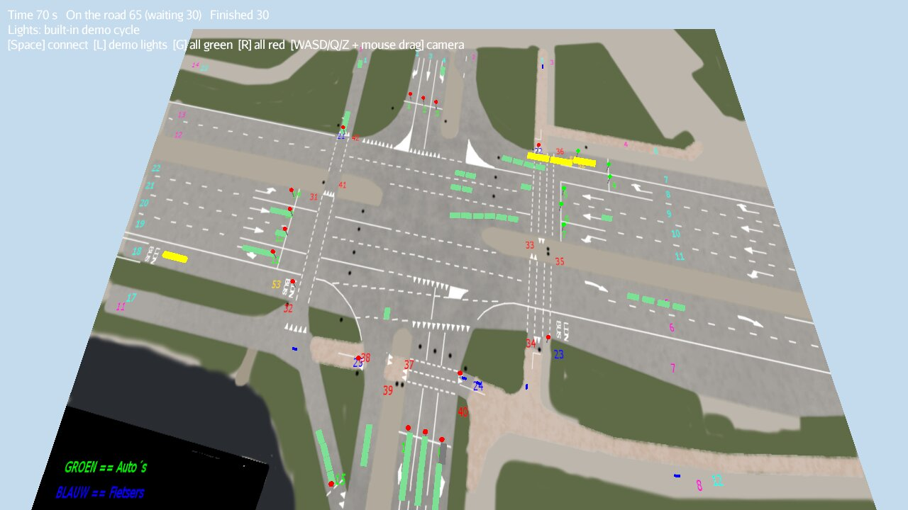

# Simplified Simulator

A 3D traffic simulation of a single, busy crossroad, built with
[jMonkeyEngine](https://jmonkeyengine.org/). Cars, buses and cyclists enter
the crossroad according to a scenario file and follow recorded routes. They stop
at red lights and queue behind each other. The traffic lights are switched by an
external **traffic light controller** that talks to the simulator over TCP. A
built-in fixed-time controller is included so the simulator can also run on its
own.



The simulator started as a school project in 2014, made by Toby Zeldenrust and
Herman ten Hoor. It is the visual half of a traffic control system: a separate
controller application decides when each light changes, and the simulator shows
the effect on the traffic and reports waiting road users back to it. The code has
since been modernised: it now builds with Gradle on current Java and
jMonkeyEngine versions, the networking runs off the render thread, and the
scenario, route and protocol code has unit tests.

## Requirements

- JDK 17 or newer
- A graphics card or driver that supports OpenGL 3.2 (not needed for headless runs)

Gradle does not need to be installed, because the wrapper downloads it.

## Running

```sh
./gradlew run                                   # large scenario, waits for a controller
./gradlew run --args="--demo"                   # use the built-in light controller
./gradlew run --args="--host 192.168.1.20 --port 1337 --connect --scenario small"
```

On Windows, use `gradlew.bat` instead of `./gradlew`.

To build a standalone distribution with start scripts, run `./gradlew installDist`.
The output goes to `build/install/simplified-simulator/`.

### Options

| Option              | Default     | Description                                                       |
|---------------------|-------------|-------------------------------------------------------------------|
| `--host <name>`     | `localhost` | Host of the traffic light controller                              |
| `--port <number>`   | `1337`      | Port of the traffic light controller                              |
| `--scenario <name>` | `large`     | `small`, `medium`, `large`, or the path to your own scenario file |
| `--connect`         |             | Connect to the controller on start-up                             |
| `--demo`            |             | Start with the built-in fixed-time light controller               |
| `--headless`        |             | Run without a window, for example to test a controller            |
| `--duration <sec>`  | `0` (off)   | Quit after this many seconds                                      |
| `--record <file>`   |             | Draw a new route on the map instead of simulating (see below)     |

### Controls

| Key                     | Action                                          |
|-------------------------|-------------------------------------------------|
| `Space`                 | Connect to the traffic light controller         |
| `L`                     | Turn the built-in demo light controller on/off  |
| `G` / `R`               | Set all lights to green / red (manual override) |
| `W` `A` `S` `D` `Q` `Z` | Move the camera                                 |
| Mouse drag              | Rotate the camera                               |
| `Esc`                   | Quit                                            |

## How it works

```
src/main/java/simplifiedsimulator
├── Main.java                  command line parsing, jME start-up
├── SimplifiedSimulator.java   the application: spawning, update loop, HUD, keys
├── Vehicle.java               a road user that follows its route and waits when blocked
├── TrafficLight.java          a light with a stop zone and a sensor
├── TrafficLightLayout.java    light positions and the demo light phases
├── DemoLightController.java   fixed-time controller for running without a server
├── CrossroadScene.java        the textured crossroad floor
├── RouteRecorderState.java    drawing new routes on the map
├── scenario/                  scenario (XML) and route file parsing
└── net/                       controller protocol and TCP client
```

Every frame, each road user checks whether it touches the stop zone of a light
that is not green, or a road user that entered before it. If it does, its motion
pauses until the way is clear. Because only the newer of two road users waits,
queues can never deadlock. The first road user to reach a light's stop zone
triggers that light's sensor, which sends a message to the controller.

### Controller protocol

The simulator is the TCP client and the controller is the server. Messages in
both directions are JSON objects, each terminated by a NUL byte (`\0`).

When a road user arrives at light `id`, the simulator sends:

```json
{"sensorstate":{"id":5}}
```

The sensor fires at most once per light phase. It is re-armed when the light
turns red or green again.

To switch a light, the controller sends this message. The `state` value is
`0` for red, `1` for orange and `2` for green:

```json
{"lightstate":{"id":5,"state":2}}
```

Keys are matched case-insensitively. Messages that cannot be parsed are logged
and ignored.

The light ids match the numbers on the map: 1–15 are car lights, 21–25 cycle
lights and 51–53 bus lights.

### Scenario files

A scenario lists the road users to spawn. `Time` is the number of seconds after
the start of the simulation, and `StartPoint` and `EndPoint` are the entry and
exit numbers from the map.

```xml
<Data>
  <Item><Type>2</Type><StartPoint>8</StartPoint><EndPoint>2</EndPoint><Time>0</Time></Item>
  <Item><Type>3</Type><StartPoint>18</StartPoint><EndPoint>7</EndPoint><Time>4</Time></Item>
</Data>
```

| Type | Road user                                   |
|------|---------------------------------------------|
| 0    | Cyclist (blue)                              |
| 1    | Pedestrian (not simulated)                  |
| 2    | Car (green)                                 |
| 3    | Bus (yellow)                                |
| 4    | Other vehicle (grey)                        |

The built-in scenarios have 150 (`small`), 400 (`medium`) and 1200 (`large`)
road users.

### Route files

Each route from entry point `a` to exit point `b` is stored in
`src/main/resources/routes/a-b.txt`, as a list of waypoints in world
coordinates:

```
(-15.618567, 1.5, 251.05597)(-14.261513, 1.5, 223.41939)(-13.113906, 1.5, 193.11407)
```

The height value is ignored. Road users that need a route with no file are
skipped, and a warning is logged. The built-in scenarios use one route that was
never recorded, `1-4`.

To add a route, start the simulator in recording mode:

```sh
./gradlew run --args="--record build/1-4.txt"
```

Right-click on the map to add waypoints along the lane, then press `Enter` to
save them. `Backspace` removes the last waypoint and `C` starts over. Copy the
saved file into `src/main/resources/routes/`.

## Tests

```sh
./gradlew test
```

The tests cover scenario and route parsing, route recording, the controller
protocol, the TCP client (against a local server socket), the command line
options and the demo light controller. CI also runs the simulator headless for
20 seconds as a smoke test.
